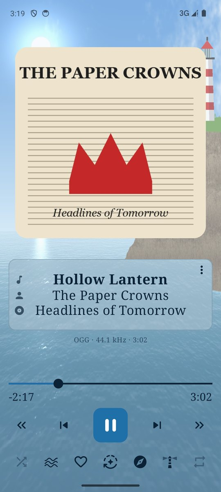
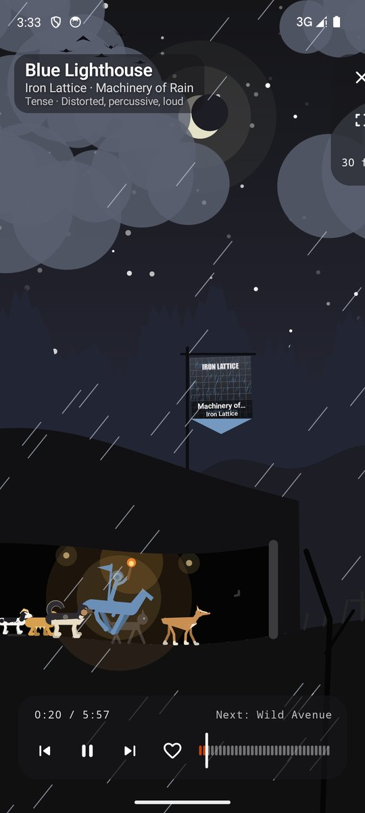
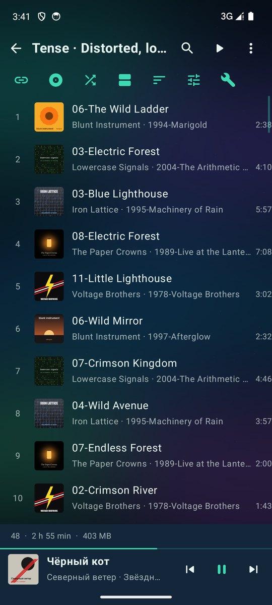
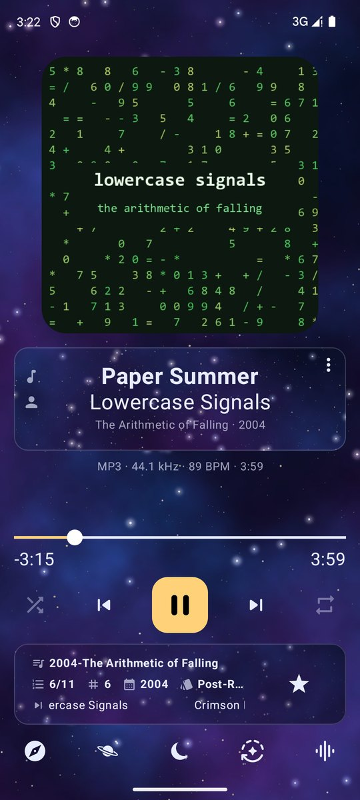
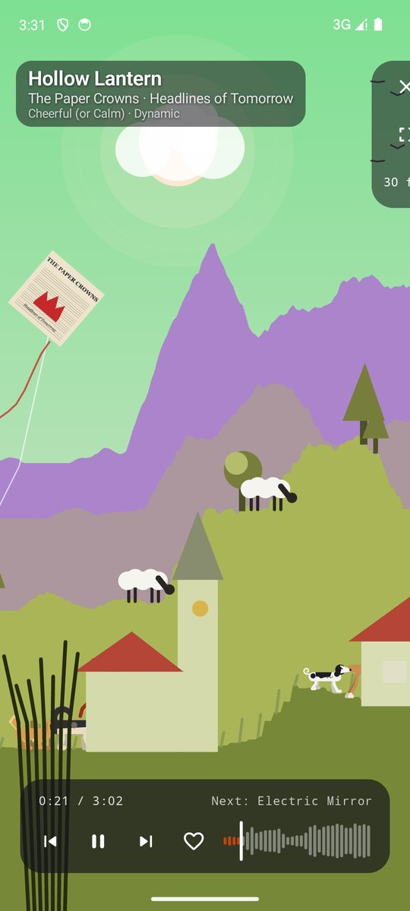

<p align="center">
  
</p>

# Attacca

*Attacca [atˈtakka]: in music, go straight on to the next movement, without a pause.*

> ### “Rediscover your music collection: hear it in new ways, with the best sound.”

**Your own music, played as if someone had listened to every track first.** Attacca measures
your files right on your phone — how each track starts and ends, how it sounds, its mood — and
plays them so one song flows into the next.

- 🔗 **Chained lists.** It hears how each track ends and the next begins (tempo, key, timbre,
  energy) and puts any list in an order where every change feels natural. A whole list from a
  single track, in one tap.
- 🎚️ **A complete sound chain.** Graphic and parametric equalizer with headphone corrections,
  dynamic and virtual bass, stereo width, crossfeed, compressor and true-peak limiter; gapless
  playback, crossfades that follow how each track ends, silence trimming, ReplayGain. A profile
  for each output: headphones, car, speaker.
- 🌄 **O'rama: watch the song.** A moving landscape drawn from the song's waveform, mood and
  beat: someone runs, rides or flies through castles, cities, seas and space, jumping on the
  strong beats, through tunnels with a torch, towards a gate into the next track's world. And a few little
  surprises to find.
- 🎭 **Moods and sound families, found by ear.** A sound-recognition network runs on the phone
  itself and groups your music by how it sounds: lists by mood and family, without anyone
  else's tags.
- 🎨 **Make it yours.** Themes with their own colours, fonts, backgrounds and icons, and a Now
  playing screen you lay out piece by piece; a gallery of themes to start from.
- 🔒 **Private by design.** No internet permission, no account, no ads, no tracking. Free and
  open source, in 23 languages.
- 💻 **Not only on the phone.** Attacca Desktop (Windows, Linux, macOS), a web page and a plugin
  for Rockbox players chain your music the same way and share what was measured.

<p align="center">
  
  
  
  
  
</p>

It comes in four parts that measure the same way and share what they measured:

| Part | What it is | Where |
|---|---|---|
| **Attacca** | Music player for Android: chained lists, its own sound processing, themes, Android Auto, and O'rama (the song as a moving landscape). | [`android/`](android) |
| **Attacca Desktop** | For the PC (Windows, Linux, macOS): plays music as the phone does (crossfades, sound processing), measures a music library, makes chained lists, exports them for the phone and for players, shows O'rama. Window and command line. | [`desktop/`](desktop) |
| **Attacca Web** | Chained lists in the browser from a library exported by Attacca Desktop. One HTML file, nothing to install. | [`web/`](web) |
| **Attacca for Rockbox** | Plugin for Rockbox players: chained lists on the player itself. | [`rockbox/`](rockbox) |

The phone and the PC exchange their libraries (`.attlib`: tags, silences, loudness, analysis), so a
collection is measured once. Attacca Desktop exports a compact library (`.bpcr2`) for the web page
and the Rockbox plugin.

## Download

Each [release](https://github.com/sadurni/attacca/releases) has the Android APK, the desktop installers and packages, the web
page and the Rockbox plugin builds. Attacca Web also runs straight from
[sadurni.github.io/attacca](https://sadurni.github.io/attacca/). The Android app is on its way to
F-Droid as well.

## Repository

```
android/     the Android app (Gradle project)
desktop/     Attacca Desktop (Gradle project, Compose for Desktop)
core/        what both share: analysis, chaining, list making, playlist and exchange formats,
             the sound classifier's weights (pure Kotlin, built with each of them)
web/         Attacca Web (a single HTML file)
rockbox/     the Rockbox plugin (C, built against the Rockbox source)
fastlane/    store texts, screenshots and the notes of each version (F-Droid reads them; the app
             shows the notes in What's new)
tools/       export_soundnet.py: makes the sound classifier's weights from the published model
docs/        the icon
```

Building: see each part's README. Versions: one number for every part; version codes of the app
are major × 100 + minor × 10 + patch.

## Privacy and contributing

Nothing is collected and nothing leaves your devices: see [PRIVACY.md](PRIVACY.md). Reports and
changes are welcome: see [CONTRIBUTING.md](CONTRIBUTING.md).

## License

MIT (see [LICENSE](LICENSE)), except the Rockbox plugin: GPL v2 or later, as Rockbox plugins are
(see [rockbox/LICENSE](rockbox/LICENSE)). Third-party components and the YAMNet sound classifier's
weights (Apache License 2.0): see [NOTICE](NOTICE).
